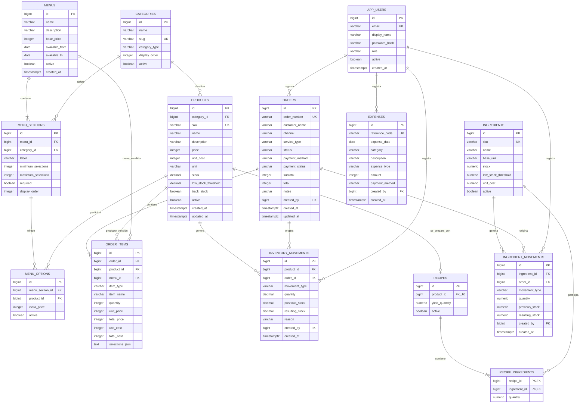

# Modelo entidad-relación — Buen Plato

Fotos de producto: almacenamiento convencional `storage/products/{productId}.png`,
una imagen por producto, servida por GET /api/products/{id}/photo. La relación usa
el identificador existente; no hay nueva columna ni migración. POST en esa ruta
reemplaza la foto (solo ADMIN). Respaldar el volumen image-storage junto con la BD.

## V6: correcciones completas de ventas

`orders.revision` aumenta con cada edición. `order_revisions` pertenece a una
venta (`order_id`), conserva `previous_revision`, `snapshot_json`, `edited_by`
y `created_at`. Relación: orders 1 → N order_revisions. Las líneas actuales se
reemplazan dentro de la transacción sin cambiar el identificador ni fecha de venta.
Los movimientos EDIT_RETURN compensan el consumo neto histórico antes de registrar
el nuevo SALE. Una corrección fallida revierte todo. Las notificaciones se derivan
de ventas y stock; sus marcas de lectura se guardan localmente por usuario.

El historial de ventas consulta `order_items.selections_json` para presentar la
composición histórica del buffet. No se modifica el esquema ni se necesita una
migración: nombres, cantidades y recargos ya estaban guardados al confirmar la venta.

Fotos demostrativas de ventas: archivos compartidos en `storage/demo-images`,
persistidos mediante el volumen Docker `image-storage`. No se agregan columnas
ni relaciones: son ilustraciones genéricas, no imágenes asignadas a cada producto.
Se deben respaldar los volúmenes de imágenes y de PostgreSQL por separado.

La migración `V5__ingredient_images.sql` agrega `ingredients.image_url`,
VARCHAR(2048) nullable: enlace HTTPS opcional a la foto de la materia prima.
No modifica relaciones, recetas ni existencias existentes.

Este documento describe la estructura lógica inicial de la base de datos. El
modelo está orientado a productos, menús configurables, ventas e inventario.

> Documento vivo: debe actualizarse junto con cualquier cambio de tablas,
> relaciones, claves, restricciones, migraciones o reglas de persistencia. Una
> modificación de base de datos no se considera terminada hasta verificar que
> este MER coincide con las migraciones Flyway y el comportamiento del backend.

## Diagrama MER



## Lectura de las relaciones

| Relación | Cardinalidad | Significado |
|---|---:|---|
| Categoría → Producto | 1 a 0..N | Una categoría puede clasificar varios productos; cada producto pertenece a una categoría. |
| Menú → Sección | 1 a 1..N | Un menú debe contener una o más secciones configurables. |
| Categoría → Sección | 1 a 0..N | Una sección representa una categoría, como proteína o ensalada. |
| Sección → Opción | 1 a 0..N | Una sección puede ofrecer varios productos para seleccionar. |
| Producto → Opción | 1 a 0..N | Un producto puede participar en diferentes menús o secciones. |
| Usuario → Pedido | 1 a 0..N | Un usuario puede registrar muchos pedidos. |
| Pedido → Ítem | 1 a 1..N | Todo pedido confirmado debe contener al menos un ítem. |
| Producto → Ítem | 1 a 0..N | Un ítem puede representar un producto vendido por separado. |
| Menú → Ítem | 1 a 0..N | Un ítem puede representar un menú configurado. |
| Producto → Movimiento | 1 a 0..N | Cada entrada o salida de stock pertenece a un producto. |
| Pedido → Movimiento | 1 a 0..N | Una venta puede originar varios descuentos de inventario. |
| Usuario → Movimiento | 1 a 0..N | Los ajustes manuales conservan al usuario responsable. |
| Usuario → Gasto | 1 a 0..N | Los gastos operacionales conservan al usuario que los registró. |

## Responsabilidad de cada entidad

### `app_users`

Personas autorizadas para utilizar el sistema administrativo. El campo `role`
permitirá distinguir administrador, cajero, cocina y encargado de inventario.

### `categories`

Clasifica productos y define los tipos de componentes de un menú. Ejemplos:
proteína, agregado, ensalada, postre, bebida y extra.

### `products`

Catálogo único de elementos vendibles o seleccionables. Contiene precio
individual, unidad de control, stock y umbral de alerta.

### `menus`

Define un producto compuesto con precio base y vigencia. Un menú no guarda sus
productos directamente; los organiza mediante secciones y opciones.

### `menu_sections`

Establece las reglas de selección de cada parte del menú. Por ejemplo:
“selecciona exactamente una proteína” o “selecciona hasta dos ensaladas”.

### `menu_options`

Relaciona un producto con una sección del menú. `extra_price` permite aplicar
recargos como carne mechada por `+$1.500`.

### `orders`

Encabezado de la venta. Conserva número, canal, modalidad de atención, estado,
pago y totales definitivos.

### `order_items`

Detalle de productos y menús vendidos. Guarda nombre y precios históricos para
que una modificación posterior del catálogo no altere ventas antiguas.

`selections_json` será una fotografía de las opciones incluidas en un menú
vendido. En una fase posterior se evaluará normalizar esta información en una
tabla `order_item_selections` si se requieren reportes detallados por componente.

Una venta puede contener ítems de tipo `MENU` y varios ítems de tipo `PRODUCT`:

- Una línea `MENU` puede representar varios almuerzos mediante `quantity`.
- `selections_json` guarda cada opción elegida con su cantidad explícita. Por
  ejemplo: 3 menús, 2 porciones de pollo y 1 de carne.
- En cada sección, la suma de cantidades debe cumplir
  `minimum_selections × quantity` y `maximum_selections × quantity`.
- De esta forma, las proteínas, agregados, ensaladas y postres se distribuyen
  dentro de una sola línea y no se repiten visualmente en el pedido.
- La bebida se registra como un ítem `PRODUCT` aparte.
- Cualquier producto activo puede agregarse como extra y se registra como un
  ítem `PRODUCT`.
- El inventario descuenta la cantidad exacta de cada opción registrada en
  `selections_json`.

### `inventory_movements`

Libro de movimientos del inventario. Registra compras, ventas, mermas, ajustes,
devoluciones y sus existencias anterior y resultante.

Esta tabla conserva temporalmente movimientos directos de productos antiguos
sin receta. El inventario operativo nuevo utiliza `ingredient_movements`.

### `ingredients`

Representa materias primas, no platos preparados. El stock se normaliza en
`G`, `ML` o `UNIT`; de ese modo 1 kg equivale a 1000 g y 1 litro a 1000 ml.

### `recipes`

Representa una preparación ajustable y solo puede ser mantenida por el administrador general. Todo producto alimenticio preparado debe relacionarse con una receta. Los productos de categoría `Bebestibles` son comprados listos para la venta, no llevan receta y controlan stock por unidad.

El nombre comercial continúa perteneciendo a `products`; el formulario de preparación puede actualizarlo junto con el rendimiento.

Asocia como máximo una receta activa a cada producto vendible. `yield_quantity`
indica cuántas porciones produce el lote completo.

### `recipe_ingredients`

Define la cantidad de cada materia prima necesaria para producir el rendimiento
de la receta. La clave compuesta impide repetir un ingrediente en el mismo plato.

### `ingredient_movements`

Audita cada entrada o salida de materia prima, incluyendo stock anterior,
resultado, pedido, usuario y motivo.

### `expenses`

Registra egresos fijos y variables del local. Junto con el costo histórico
guardado en `order_items`, permite calcular utilidad bruta, resultado
operacional y punto de equilibrio sin depender de valores escritos en el
frontend.

## Claves y abreviaciones

- `PK`: clave primaria.
- `FK`: clave foránea.
- `UK`: valor único.
- `1..N`: uno o muchos.
- `0..N`: ninguno o muchos.

## Reglas de integridad

1. Los precios se almacenan como enteros en pesos chilenos.
2. `products.price`, `menus.base_price` y `menu_options.extra_price` no pueden
   ser negativos.
3. Un producto debe pertenecer a una categoría.
4. Una sección no puede repetir la misma categoría dentro de un menú.
5. Un producto no puede repetirse dentro de una misma sección.
6. La selección mínima no puede superar la selección máxima.
7. Un ítem debe apuntar a un producto o a un menú según `item_type`.
8. Un pedido confirmado debe tener al menos un ítem.
9. El total se calcula en el backend usando precios vigentes.
10. La creación del pedido y los movimientos de inventario se ejecutan en una
    única transacción.
11. El stock no puede quedar negativo, salvo que en el futuro se habilite una
    política explícita de sobreventa.
12. Las ventas históricas no deben cambiar cuando se actualice un precio.
13. Los registros utilizados históricamente se desactivan en lugar de borrarse.
14. Un pedido puede incluir cero o más menús configurados y cero o más productos
    adicionales, pero siempre debe contener al menos uno de ellos.
15. Cada menú del pedido debe cumplir de forma independiente los mínimos y
    máximos definidos por sus secciones.
16. Bebidas y productos extra no forman parte del precio base del menú.
17. Las recetas se expresan por lote y deben tener rendimiento mayor que cero.
18. Peso, volumen y unidades no pueden mezclarse; kg/l se convierten a g/ml.
19. Una venta descuenta `cantidad_receta / rendimiento * porciones_vendidas`.
20. Una materia prima utilizada en una receta no puede desactivarse.
21. Todo producto activo cuya categoría no sea `Bebestibles` necesita una receta activa para venderse.
22. Los productos de `Bebestibles` no llevan receta y descuentan `products.stock` por unidad vendida.
23. Los seeders pueden completar ingredientes y recetas faltantes, pero no modificar stock ni preparaciones existentes.
24. Eliminar una materia prima significa desactivarla; si participa en una receta, la operación se rechaza hasta modificar esa preparación.

## Estados propuestos

### Pedido

```text
PENDING → PAID → PREPARING → READY → COMPLETED
                  ↘ CANCELLED
```

### Pago

```text
PENDING → PAID → REFUNDED
```

### Tipos de movimiento

- `PURCHASE`: ingreso por compra o producción.
- `SALE`: salida asociada a una venta.
- `ADJUSTMENT`: corrección manual.
- `WASTE`: merma.
- `RETURN`: devolución al inventario.

## Posibles ampliaciones

Estas entidades no se incorporan todavía para mantener un primer modelo
manejable:

- `customers`: clientes registrados y datos de contacto.
- `payments`: múltiples intentos o pagos parciales por pedido.
- `order_item_selections`: selecciones normalizadas para análisis detallado.
- `locations`: soporte para múltiples locales.
- `cash_sessions`: apertura, cierre y arqueo de caja.
- `audit_log`: auditoría general de acciones administrativas.
- `tax_documents`: boletas y documentos tributarios electrónicos.

Su incorporación se realizará solamente cuando el flujo funcional lo requiera.
